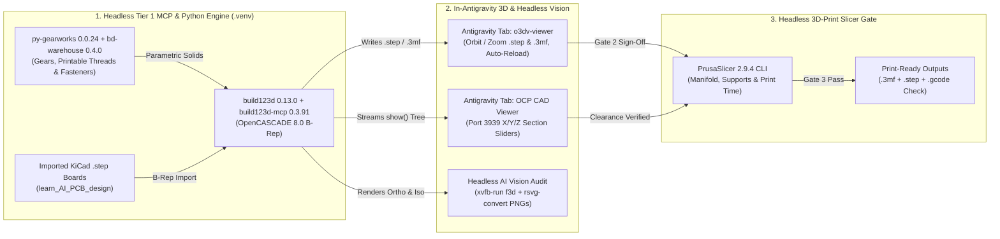
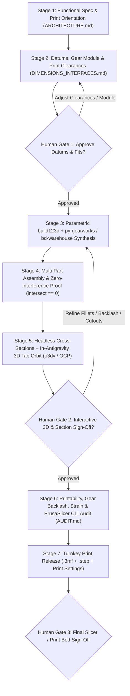
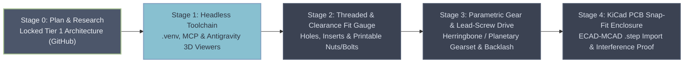

# <span style="color: #88C0D0;">**Headless AI-Assisted 3D-Printing CAD Pipeline: Stage 0 Architecture Plan**</span>

### <span style="color: #81A1C1;">**Filename:** `overall.md`</span>

| <span style="color: #EBCB8B;">**Field**</span> | <span style="color: #EBCB8B;">**Details**</span> |
| :--- | :--- |
| <span style="color: #EBCB8B;">**Author**</span> | devilsu |
| <span style="color: #EBCB8B;">**Created**</span> | 2026-11-20 PST |
| <span style="color: #EBCB8B;">**Modified**</span> | 2026-11-21 PST |
| <span style="color: #EBCB8B;">**Version**</span> | v2.1.0 |
| <span style="color: #EBCB8B;">**Host / Mode**</span> | `Ubuntu 26.04.1 LTS` / `Python 3.14.4` (100% Headless Remote-SSH via Antigravity) |
| <span style="color: #EBCB8B;">**Primary Scope**</span> | 3D Printing (`.3mf` / `.stl` / `.step`) + Gears, Printable Screws & KiCad Enclosures (Zero FEA/CNC) |
| <span style="color: #EBCB8B;">**Reference Template**</span> | [`learn_AI_PCB_design`](https://github.com/DevilSu/learn_AI_PCB_design) |
| <span style="color: #EBCB8B;">**Supporting Research**</span> | [8-Tool CAD Survey](research/cad_software_landscape_3dp.md) / [CAD MCP Analysis](research/cad_mcp_pros_cons_concerns.md) / [Project Diary](diary.md) |
| <span style="color: #EBCB8B;">**Status**</span> | <span style="color: #A3BE8C;">**Locked v2.1.0 (Tier 1 Pure Python Stack — Plan Published, Scaffolding Deferred)**</span> |

---

## <span style="color: #88C0D0;">**Table of Contents**</span>
- [<span style="color: #88C0D0;">**1. Core Architecture and PCB-to-CAD Mapping**</span>](#1-core-architecture-and-pcb-to-cad-mapping)
  - [<span style="color: #81A1C1;">1.1 Locked Headless Tier 1 Remote-SSH Architecture</span>](#11-locked-headless-tier-1-remote-ssh-architecture)
  - [<span style="color: #81A1C1;">1.2 1-to-1 Mapping: AI PCB Pipeline to AI CAD Pipeline</span>](#12-1-to-1-mapping-ai-pcb-pipeline-to-ai-cad-pipeline)
- [<span style="color: #88C0D0;">**2. Headless Tier 1 Stack, MCP Choice and Antigravity 3D Viewers**</span>](#2-headless-tier-1-stack-mcp-choice-and-antigravity-3d-viewers)
  - [<span style="color: #81A1C1;">2.1 Why Desktop GUIs, Cloud Quotas and Dual-Engine Bloat Were Filtered Out</span>](#21-why-desktop-guis-cloud-quotas-and-dual-engine-bloat-were-filtered-out)
  - [<span style="color: #81A1C1;">2.2 Headless Tier 1 Toolchain and Antigravity Viewport Dataflow</span>](#22-headless-tier-1-toolchain-and-antigravity-viewport-dataflow)
  - [<span style="color: #81A1C1;">2.3 Locked Tier 1 Component and Storage Breakdown</span>](#23-locked-tier-1-component-and-storage-breakdown)
- [<span style="color: #88C0D0;">**3. Parametric CAD Operations and External GUI Handoff**</span>](#3-parametric-cad-operations-and-external-gui-handoff)
  - [<span style="color: #81A1C1;">3.1 Ordered Feature Operations and Dataclass Parametrics</span>](#31-ordered-feature-operations-and-dataclass-parametrics)
  - [<span style="color: #81A1C1;">3.2 Opening Exported STEP Files in External GUI CAD</span>](#32-opening-exported-step-files-in-external-gui-cad)
- [<span style="color: #88C0D0;">**4. Seven-Stage Gated 3D-Printing Workflow and Tolerance Math**</span>](#4-seven-stage-gated-3d-printing-workflow-and-tolerance-math)
  - [<span style="color: #81A1C1;">4.1 Gated Pipeline and Human Sign-Off Flow</span>](#41-gated-pipeline-and-human-sign-off-flow)
  - [<span style="color: #81A1C1;">4.2 Deterministic Gear, Screw and Snap-Fit Print Checks</span>](#42-deterministic-gear-screw-and-snap-fit-print-checks)
- [<span style="color: #88C0D0;">**5. Planned Repository Structure and Progressive Testbed Roadmap**</span>](#5-planned-repository-structure-and-progressive-testbed-roadmap)
  - [<span style="color: #81A1C1;">5.1 Target Future Scaffolding Layout</span>](#51-target-future-scaffolding-layout)
  - [<span style="color: #81A1C1;">5.2 Progressive Validation Roadmap and ECAD-MCAD Bridge</span>](#52-progressive-validation-roadmap-and-ecad-mcad-bridge)
- [<span style="color: #88C0D0;">**6. Locked Decisions and GitHub Readiness Status**</span>](#6-locked-decisions-and-github-readiness-status)

---

## <span style="color: #88C0D0;">**1. Core Architecture and PCB-to-CAD Mapping**</span>

### <span style="color: #81A1C1;">**1.1 Locked Headless Tier 1 Remote-SSH Architecture**</span>

Mirroring [`learn_AI_PCB_design`](https://github.com/DevilSu/learn_AI_PCB_design), this project locks down the architecture, research, and progressive testbed plan before installing packages or scaffolding code directories (`hw/` and `sw/` scaffolding is explicitly deferred until Stage 1 kickoff). Based on our empirical host audit and comparison, the architecture is locked on <span style="color: #EBCB8B;">**Tier 1 (Pure `Python 3.14` B-Rep + Headless MCP)**</span>:

1. <span style="color: #EBCB8B;">**100% Headless Host Execution (Remote-SSH Safe):**</span> Nothing on the Ubuntu 26.04 host ever opens an X11 or Wayland CAD GUI window. B-Rep compilation, MCP inspection, PNG rendering (`xvfb-run` + `f3d` + `rsvg-convert`), and printability checks (`PrusaSlicer 2.9.4` CLI) run purely headlessly.
2. <span style="color: #EBCB8B;">**Interactive 3D Viewing Inside Antigravity:**</span> You rotate, pan, zoom, toggle sub-parts, and scrub X/Y/Z cross-section planes directly inside Antigravity WebGL tabs (`nahueltaibo.o3dv-viewer` for `.step`/`.3mf` files + `ocp-cad-viewer` over auto-forwarded port `3939`) without X11 forwarding.
3. <span style="color: #EBCB8B;">**Single-Language Python B-Rep + MCP Control:**</span> Uses `build123d` (`0.13.0`) + `build123d-mcp` (`0.3.91`) on OpenCASCADE (`cadquery-ocp 8.0.1.1.0`), saving deterministic, Git-reproducible `.py` scripts rather than fragile click-ops GUI state.
4. <span style="color: #EBCB8B;">**Gears, Printable Screws & PCB Enclosures in Pure Python:**</span> Live PyPI wheel inspection verified zero gear or thread gaps in Tier 1—`bd-warehouse 0.4.0` already ships `SpurGear`, `HelicalGear`, `RackGear`, `Worm`, `WormWheel`, `WormGear`, `Sprocket`, `Bearing`, `IsoThread`, `AcmeThread`, `MetricTrapezoidalThread`, and `PlasticBottleThread`, while `py-gearworks 0.0.24` adds `BevelGear`, `PlanetaryGearset`, `SpurRingGear`, `HelicalRingGear`, and `CycloidGear` with profile shifts and FDM `backlash`, plus KiCad `.step` imports for enclosures.
5. <span style="color: #EBCB8B;">**3D-Printing-Only Scope (Zero FEA / Zero CNC Bloat):**</span> Structural/thermal FEA (`gmsh`, `calculix-ccx`) and CNC endmill/sheet-metal checks are omitted completely.

### <span style="color: #81A1C1;">**1.2 1-to-1 Mapping: AI PCB Pipeline to AI CAD Pipeline**</span>

| <span style="color: #EBCB8B;">**Pipeline Pillar**</span> | <span style="color: #EBCB8B;">**`learn_AI_PCB_design` (Completed Stage 0)**</span> | <span style="color: #EBCB8B;">**`learn_AI_CAD_design` (Locked Tier 1 Headless)**</span> |
| :--- | :--- | :--- |
| <span style="color: #EBCB8B;">**Geometry Kernel**</span> | Native `apt` KiCad 9 (`pcbnew`) | `cadquery-ocp 8.0.1.1.0` (OpenCASCADE B-Rep `.step`/`.3mf` in `.venv`) |
| <span style="color: #EBCB8B;">**Parametric Authoring**</span> | `kicad-sch-api` / `circuit-synth` + `pcbnew` | `build123d 0.13.0` (`BuildPart` feature sequence + `@dataclass` parameters) |
| <span style="color: #EBCB8B;">**MCP Control Layer**</span> | Headless CLI + scripts (optional KiCad IPC) | `build123d-mcp 0.3.91` (`Python 3.14` native) |
| <span style="color: #EBCB8B;">**Gears, Screws & Parts**</span> | `/usr/share/kicad` + `easyeda2kicad` (`Cxxxx`) | `py-gearworks 0.0.24` + `bd-warehouse 0.4.0` + KiCad `.step` boards |
| <span style="color: #EBCB8B;">**In-Antigravity 3D & Renders**</span> | `kicad-cli pcb render` & `rsvg-convert` PNGs | `nahueltaibo.o3dv-viewer` + `ocp-cad-viewer` tabs (orbit/zoom) + headless `f3d` / `rsvg-convert` PNGs |
| <span style="color: #EBCB8B;">**3D-Print DFM & Release**</span> | `KiBot` (`gerbers.zip` + JLCPCB BOM/CPL) | Headless `prusa-slicer 2.9.4` CLI slice audit -> `.3mf` + `.step` + print settings sheet |

---

## <span style="color: #88C0D0;">**2. Headless Tier 1 Stack, MCP Choice and Antigravity 3D Viewers**</span>

### <span style="color: #81A1C1;">**2.1 Why Desktop GUIs, Cloud Quotas and Dual-Engine Bloat Were Filtered Out**</span>

Our full 8-tool and MCP audit ([8-tool landscape](research/cad_software_landscape_3dp.md) & [MCP trade-offs](research/cad_mcp_pros_cons_concerns.md)) surfaced six concrete blockers on this `Ubuntu 26.04.1 LTS` (`Python 3.14.4`) Remote-SSH host:

* <span style="color: #EBCB8B;">**Autodesk Fusion (`fusion360-mcp`):**</span> No native Linux desktop app (`wine` is not installed); Cloud Compute MCP removes local interactive control.
* <span style="color: #EBCB8B;">**FreeCAD (`freecad-mcp 0.1.32`):**</span> Missing from Ubuntu 26.04 `apt` (forcing AppImage/Snap), requires an always-open desktop Qt GUI over `127.0.0.1:9875`, and freezes the Qt main thread on heavy helical thread booleans.
* <span style="color: #EBCB8B;">**Onshape (`onshape-mcp`):**</span> Requires leaving Antigravity for an external browser GUI, enforces a strict **`2,500 API calls/year`** Free quota (which iterative MCP loops can exhaust in days), and forces Free-tier designs to be **100% public**.
* <span style="color: #EBCB8B;">**SolidCraft (`solidcraft-cli mcp`):**</span> Open-source Rust GUI/CLI, but its young `truck`/`solidcore` kernels still hit documented multi-edge fillet hangs, bugs where modeled threads break subsequent fillets, and lack an involute gear library.
* <span style="color: #EBCB8B;">**`agentcad 0.8.0` Wrapper Trap:**</span> Live PyPI inspection confirmed `agentcad` pins `Python <3.13` (incompatible with Ubuntu 26.04's `Python 3.14.4`), whereas `build123d-mcp 0.3.91` (`<3.15,>=3.11`) supports `Python 3.14` natively.
* <span style="color: #EBCB8B;">**Why `openscad-mcp` + `BOSL2` Was Deferred:**</span> OpenSCAD outputs polygon meshes only (**no `.step` export** for external CAD handoff or KiCad PCB imports) and would add a second `.scad` language plus an external `Manifold` AppImage/Snap. Because `bd-warehouse 0.4.0` + `py-gearworks 0.0.24` already provide worm, bevel, planetary, helical, spur, cycloid, and rack gears plus metric/Acme/trapezoidal/bottle threads in pure Python, keeping **Tier 1** avoids unnecessary stack split *(leaving `BOSL2` strictly as an optional future fallback if specialty hose/mason-jar presets are ever needed)*.

### <span style="color: #81A1C1;">**2.2 Headless Tier 1 Toolchain and Antigravity Viewport Dataflow**</span>



<span style="color: #EBCB8B;">**How Your In-Antigravity 3D Inspection Works Over Remote-SSH:**</span>
1. <span style="color: #EBCB8B;">**`3D Model Viewer` (`nahueltaibo.o3dv-viewer`):**</span> Click any `.step`, `.3mf`, or `.stl` file in Antigravity's Explorer to orbit, pan, zoom, snap to ViewCube faces, isolate assembly parts, and **auto-refresh while keeping your camera angle** whenever a script regenerates the file.
2. <span style="color: #EBCB8B;">**`OCP CAD Viewer` (`ocp-cad-viewer` + `ocp-vscode 4.2.0`):**</span> Streams `build123d`'s `show()` over forwarded port `3939` into an Antigravity editor tab, giving you a **feature/part tree**, **live X/Y/Z cross-section sliders** (to inspect internal gear mesh & screw thread gaps), and face-to-face distance measurement.

### <span style="color: #81A1C1;">**2.3 Locked Tier 1 Component and Storage Breakdown**</span>

| <span style="color: #EBCB8B;">**Layer**</span> | <span style="color: #EBCB8B;">**Locked Tier 1 Packages & Extensions**</span> | <span style="color: #EBCB8B;">**Est. Unpacked Size**</span> | <span style="color: #EBCB8B;">**Role in Pipeline**</span> |
| :--- | :--- | :---: | :--- |
| <span style="color: #EBCB8B;">**Python `.venv` (`Python 3.14`)**</span> | `build123d` (`0.13.0`), `build123d-mcp` (`0.3.91`), `cadquery` (`2.8.0`), `cadquery-ocp` (`8.0.1.1.0`), `py-gearworks` (`0.0.24`), `bd-warehouse` (`0.4.0`), `manifold3d` (`3.5.5`), `trimesh` (`5.2.1`), `ocp-vscode` (`4.2.0`) | `~250 MB` | Parametric B-Rep geometry, MCP tool loop, all gear & thread generation, solid collision math, watertight mesh checks |
| <span style="color: #EBCB8B;">**Ubuntu 26.04 `apt` CLI**</span> | `f3d` (`3.2.0+dfsg-3`), `librsvg2-bin` (`2.61.3`), `prusa-slicer` (`2.9.4+dfsg-4`) *(plus pre-installed `xvfb 2:21.1.22`)* | `~180 MB` | Offscreen multi-angle PNG rendering, 2D SVG cross-section rasterization, headless `.3mf`/`.step` slicing & support/time verification |
| <span style="color: #EBCB8B;">**Antigravity IDE Extensions**</span> | `nahueltaibo.o3dv-viewer`, `ocp-cad-viewer` | `< 10 MB` | Interactive WebGL rotation/pan/zoom, ViewCube, part tree, and live X/Y/Z cross-section sliders inside editor tabs |
| <span style="color: #EBCB8B;">**Total Locked Footprint**</span> | **Tier 1: Pure Python B-Rep + Headless Slicer** | **`~430 MB`** | **100% local, zero quotas, `.step` + `.3mf` compatible** *(Optional future fallback: `openscad-mcp` + `BOSL2` only if specialty threads are ever needed)* |

---

## <span style="color: #88C0D0;">**3. Parametric CAD Operations and External GUI Handoff**</span>

### <span style="color: #81A1C1;">**3.1 Ordered Feature Operations and Dataclass Parametrics**</span>

`build123d` maps 1-to-1 to traditional mechanical CAD feature trees rather than raw triangle generation:

* <span style="color: #EBCB8B;">**Standard Operations:**</span> `extrude()`, `revolve()`, `loft()`, `sweep()`, `fillet()`, `chamfer()`, `offset()` (shelling), `CounterBoreHole()`, `PolarLocations()`, and `GridLocations()`, combined explicitly with `Mode.ADD`, `Mode.SUBTRACT`, and `Mode.INTERSECT`.
* <span style="color: #EBCB8B;">**Ordered Operation List:**</span> A `BuildPart()` block acts as your sequential timeline—every step executes deterministically in order, and `OCP CAD Viewer` displays individual sub-parts and sketches in a toggleable tree inside Antigravity.
* <span style="color: #EBCB8B;">**True Parametric `@dataclass` Control:**</span> Dimensions, tolerances, and gear tooth counts live in a single parameter block at the top of each script (`tooth_count`, `pcb_width`, `backlash`), recalculating all dependent shaft spacings, bosses, and clearances on re-run.

### <span style="color: #81A1C1;">**3.2 Opening Exported STEP Files in External GUI CAD**</span>

* <span style="color: #EBCB8B;">**What Works Downstream:**</span> Because `export_step()` writes exact mathematical B-Rep surfaces (analytic cylinders, planes, NURBS curves, and multi-part assemblies), you or a collaborator can open any `.step` output in **Onshape, FreeCAD, Fusion 360, or SolidWorks**, click any face to sketch, and stack additional **Extrude, Subtract/Cut, Revolve, Fillet, or Move Face** operations cleanly.
* <span style="color: #EBCB8B;">**Important One-Way Caveat:**</span> The `.step` format transfers exact 3D B-Rep geometry—not the Python source timeline. External CAD opens the model as an `Imported Base Solid` (you cannot double-click an internal Python `extrude` step inside Fusion/Onshape), and manual GUI edits made there do not sync back into `.py` scripts.

---

## <span style="color: #88C0D0;">**4. Seven-Stage Gated 3D-Printing Workflow and Tolerance Math**</span>

### <span style="color: #81A1C1;">**4.1 Gated Pipeline and Human Sign-Off Flow**</span>



### <span style="color: #81A1C1;">**4.2 Deterministic Gear, Screw and Snap-Fit Print Checks**</span>

All structural/thermal FEA simulation is omitted. Instead, Stage 2 and Stage 6 enforce three fast, deterministic 3D-printing checks inside Python/MCP:

1. <span style="color: #EBCB8B;">**Gear Pair Center Distance with FDM Fit Offset:**</span> For module $m$ and tooth counts $z_1, z_2$, scripts apply calibrated radial offset $\Delta a_{\text{clearance}}$ alongside tooth `backlash` so `0.4 mm` nozzle perimeters mesh smoothly:

$$
a_{\text{center}} = \frac{m \left(z_1 + z_2\right)}{2} + \Delta a_{\text{clearance}}
$$

2. <span style="color: #EBCB8B;">**3D-Printed Internal Thread Flank Compensation:**</span> Printed mechanical screws prefer `45 deg`–`60 deg` stub/trapezoidal flanks (printing cleanly without supports) and enforce an explicit flank clearance $c_{\text{flank}}$ between male bolts and female nuts:

$$
D_{\text{nut,print}} = D_{\text{bolt,nominal}} + 2 c_{\text{flank}}
$$

3. <span style="color: #EBCB8B;">**Cantilever Snap-Fit Base Bending Strain Check:**</span> For snap-fit PCB enclosures, scripts verify peak root strain stays below the filament's allowable yield strain $\varepsilon_{\text{allow}}$ given deflection $y_{\text{deflect}}$, root thickness $t_{\text{root}}$, and beam length $L_{\text{beam}}$:

$$
\varepsilon_{\max} = \frac{3 \cdot y_{\text{deflect}} \cdot t_{\text{root}}}{2 \cdot L_{\text{beam}}^{2}} \le \varepsilon_{\text{allow}}
$$

4. <span style="color: #EBCB8B;">**Headless Geometry & Slicer Gate:**</span> Verify `part_a.intersect(part_b).volume == 0.0`, watertight `manifold3d`/`trimesh` topology, `45 deg` bed-side chamfers, 2D mid-plane cross-sections, and clean `prusa-slicer 2.9.4` CLI slicing.

---

## <span style="color: #88C0D0;">**5. Planned Repository Structure and Progressive Testbed Roadmap**</span>

### <span style="color: #81A1C1;">**5.1 Target Future Scaffolding Layout**</span>

*(Note: Currently **only** the plan, research docs, diary, `readme.md`, and `.gitignore` are initialized on GitHub; `hw/`, `sw/`, and per-stage subproject scaffolding remain deferred until explicitly requested.)*

```text
learn_AI_CAD_design/
├── readme.md                                       # Master repository guide, Mermaid roadmap & status dashboard
├── .gitignore                                      # Python .venv, build/render outputs, .gcode & scratch mesh rules
│
├── blueprints/                                     # Architectural blueprints, research & immutable project diary
│   ├── overall.md                                  # Locked Tier 1 Stage 0 architecture plan (this blueprint)
│   ├── diary.md                                    # Append-only daily engineering journal (RULE-DIARY-001)
│   ├── research/                                   # Ecosystem & MCP research comparisons
│   │   ├── cad_software_landscape_3dp.md           # 8-tool CAD comparison for Ubuntu 3D printing, gears & screws
│   │   └── cad_mcp_pros_cons_concerns.md           # Deep-dive CAD MCP architecture, traps & Remote-SSH tradeoffs
│   ├── toolchain_setup/                            # Stage 1 (Deferred): Host setup blueprint & smoke test evidence
│   ├── threaded_fit_gauge/                         # Stage 2 (Deferred): Clearance holes, inserts & printable bolt/nut matrix
│   ├── parametric_gear_drive/                      # Stage 3 (Deferred): Herringbone/planetary/worm gearset + lead screw
│   └── pcb_snapfit_enclosure/                      # Stage 4 (Deferred): KiCad .step PCB import & snap-fit enclosure
│
├── hw/                                             # Future Scaffolding: Released 3D-printable deliverables & reference STEPs
│   ├── common/                                     # Shared FDM tolerance profiles & imported KiCad board STEPs
│   └── subprojects/                                # Isolated per-part exports (.3mf, .step, PNG renders)
│
└── sw/                                             # Future Scaffolding: Parametric build123d generators, MCP config & .venv setups
    ├── common/                                     # Shared setup_env.sh, tolerance tables, interference & render helpers
    └── subprojects/                                # Isolated per-subproject Python/SCAD generators & verification suites
```

### <span style="color: #81A1C1;">**5.2 Progressive Validation Roadmap and ECAD-MCAD Bridge**</span>



<span style="color: #EBCB8B;">**ECAD-MCAD Bridge (`Stage 4`):**</span> Importing a `.step` PCB exported from [`learn_AI_PCB_design`](https://github.com/DevilSu/learn_AI_PCB_design) into `build123d` locates M3 standoffs, header cutouts, and acoustic ports directly from the real board solid and proves `0.0 mm^3` collision—readying the same workflow for `mic_arr_v2` / `mic_arr_spatial` frames and `realtime_anc` baffles.

---

## <span style="color: #88C0D0;">**6. Locked Decisions and GitHub Readiness Status**</span>

| <span style="color: #EBCB8B;">**Decision Item**</span> | <span style="color: #EBCB8B;">**Locked Resolution**</span> |
| :--- | :--- |
| <span style="color: #EBCB8B;">**1. Repository Name & Visibility**</span> | `learn_AI_CAD_design` — **`public`** GitHub repository at `https://github.com/DevilSu/learn_AI_CAD_design` |
| <span style="color: #EBCB8B;">**2. Locked Toolchain Tier**</span> | **Tier 1 (`Python 3.14`-only `build123d` + `build123d-mcp 0.3.91` + `py-gearworks` + `bd-warehouse` + `PrusaSlicer 2.9.4` CLI + in-Antigravity `o3dv-viewer` / `OCP CAD Viewer`)**, `~430 MB` unpacked |
| <span style="color: #EBCB8B;">**3. Manufacturing & Physics Scope**</span> | **3D Printing Only** (`.3mf` + `.step`), gear trains, printable screw threads, and PCB enclosures — **zero FEA/thermal simulation and zero CNC bloat** |
| <span style="color: #EBCB8B;">**4. Current Execution State**</span> | **Plan & Research Uploaded to GitHub — `hw/` & `sw/` Scaffolding Deferred** |
