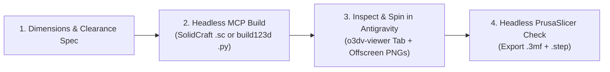
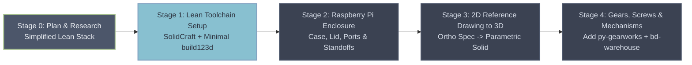

# <span style="color: #88C0D0;">**Simplified Headless AI 3D-Printing CAD Plan**</span>

### <span style="color: #81A1C1;">**Filename:** `overall.md`</span>

| <span style="color: #EBCB8B;">**Field**</span> | <span style="color: #EBCB8B;">**Details**</span> |
| :--- | :--- |
| <span style="color: #EBCB8B;">**Author**</span> | devilsu |
| <span style="color: #EBCB8B;">**Created**</span> | 2026-11-20 PST |
| <span style="color: #EBCB8B;">**Modified**</span> | 2026-11-21 PST |
| <span style="color: #EBCB8B;">**Version**</span> | v3.0.0 |
| <span style="color: #EBCB8B;">**Host / Mode**</span> | `Ubuntu 26.04.1 LTS` / `Python 3.14.4` (100% Headless Remote-SSH via Antigravity) |
| <span style="color: #EBCB8B;">**Scope**</span> | Simple Progressive 3D Printing (`RPi Enclosure` -> `Reference Drawings` -> `Gears & Screws Later`) |
| <span style="color: #EBCB8B;">**Reference Template**</span> | [`learn_AI_PCB_design`](https://github.com/DevilSu/learn_AI_PCB_design) |
| <span style="color: #EBCB8B;">**Supporting Research**</span> | [8-Tool CAD Survey](research/cad_software_landscape_3dp.md) / [CAD MCP Analysis](research/cad_mcp_pros_cons_concerns.md) / [Project Diary](diary.md) |
| <span style="color: #EBCB8B;">**Status**</span> | <span style="color: #A3BE8C;">**Simplified v3.0.0 — Ready for Stage 1 When Requested**</span> |

---

## <span style="color: #88C0D0;">**Table of Contents**</span>
- [<span style="color: #88C0D0;">**1. Lean Headless Toolchain**</span>](#1-lean-headless-toolchain)
  - [<span style="color: #81A1C1;">1.1 Base Stack and Why Gear Libraries Wait Until Stage 4</span>](#11-base-stack-and-why-gear-libraries-wait-until-stage-4)
  - [<span style="color: #81A1C1;">1.2 Lean Base Stack Breakdown</span>](#12-lean-base-stack-breakdown)
- [<span style="color: #88C0D0;">**2. Simple Four-Step Per-Part Workflow**</span>](#2-simple-four-step-per-part-workflow)
- [<span style="color: #88C0D0;">**3. Progressive Subproject Roadmap**</span>](#3-progressive-subproject-roadmap)
  - [<span style="color: #81A1C1;">3.1 Multi-Stage Progression</span>](#31-multi-stage-progression)
  - [<span style="color: #81A1C1;">3.2 Subproject Scope Breakdown</span>](#32-subproject-scope-breakdown)
- [<span style="color: #88C0D0;">**4. Target Repository Layout**</span>](#4-target-repository-layout)

---

## <span style="color: #88C0D0;">**1. Lean Headless Toolchain**</span>

### <span style="color: #81A1C1;">**1.1 Base Stack and Why Gear Libraries Wait Until Stage 4**</span>

To keep setup fast and uncluttered, we strip out upfront gear/thread libraries (`py-gearworks`, `bd-warehouse`), extra render wrappers, and all FEA/CNC bloat. We start with <span style="color: #EBCB8B;">**only what is required to model headlessly, spin 3D parts inside Antigravity over Remote-SSH, and verify 3D prints**</span>—adding gear and screw libraries only when we reach Stage 4:

* <span style="color: #EBCB8B;">**Engine A — `SolidCraft` (`solidcraft-cli mcp --headless`):**</span> Pure-Rust headless MCP server with offscreen GPU screenshots, built-in enclosure features (`extrude`, `fillet`, `shell`, `plastic.lip`, `plastic.snap_fit`, mounting bosses/holes), `.step`/`.3mf` export, and native `.sc` files that retain an <span style="color: #EBCB8B;">**editable parametric feature timeline**</span> (reopenable anytime in a browser at `https://solidcraft.io/app`). *(Host check confirmed `solidcraft` is not on the Ubuntu Snap Store, so Stage 1 installs via GitHub release `.deb` `~203 MB` or portable `.tar.gz` `~199 MB`.)*
* <span style="color: #EBCB8B;">**Engine B — Minimal `build123d` (`build123d` + `build123d-mcp`):**</span> Just two PyPI packages inside a `Python 3.14` `.venv` on OpenCASCADE 8.0 (`~245 MB`), providing rock-solid B-Rep fillets/booleans, scripted loops/math, `.step`/`.3mf` export, and ready drop-in support when Stage 4 adds `py-gearworks` and `bd-warehouse`.
* <span style="color: #EBCB8B;">**In-Antigravity 3D Viewing (`nahueltaibo.o3dv-viewer`):**</span> Click any `.step` or `.3mf` output in Explorer to rotate, pan, zoom, toggle enclosure lid/base visibility, and auto-reload directly inside an Antigravity tab over Remote-SSH *(with `ocp-cad-viewer` optional later if live X/Y/Z section sliders are wanted)*.
* <span style="color: #EBCB8B;">**Headless Printability Gate (`prusa-slicer 2.9.4` CLI):**</span> Validates watertight manifold topology, overhangs/supports, bed fit, and print time headlessly via `sudo apt install prusa-slicer`.

### <span style="color: #81A1C1;">**1.2 Lean Base Stack Breakdown**</span>

| <span style="color: #EBCB8B;">**Component**</span> | <span style="color: #EBCB8B;">**Install Source**</span> | <span style="color: #EBCB8B;">**Purpose**</span> |
| :--- | :--- | :--- |
| <span style="color: #EBCB8B;">**`SolidCraft` (`solidcraft-cli mcp --headless`)**</span> | GitHub Release `.deb` (`~203 MB`) or `.tar.gz` (`~199 MB`) | Headless MCP CAD with editable `.sc` feature timelines, enclosure lips/snap-fits & `.step`/`.3mf` export |
| <span style="color: #EBCB8B;">**`build123d` (`0.13.0`) + `build123d-mcp` (`0.3.91`)**</span> | `Python 3.14` `.venv` (`pip`) | Reliable OpenCASCADE B-Rep Python CAD + MCP; ready base for Stage 4 gear/screw packages |
| <span style="color: #EBCB8B;">**`3D Model Viewer` (`nahueltaibo.o3dv-viewer`)**</span> | Antigravity IDE Extension | In-editor 3D orbit, pan, zoom, part-tree hiding & auto-reload for `.step`/`.3mf` |
| <span style="color: #EBCB8B;">**`PrusaSlicer` (`2.9.4`) CLI**</span> | Ubuntu `apt` (`prusa-slicer`) | Headless `.3mf`/`.step` manifold, support & print-time verification |

---

## <span style="color: #88C0D0;">**2. Simple Four-Step Per-Part Workflow**</span>



Every part applies explicit 3D-print radial clearances ($c_{\text{clearance}}$, typically `0.15–0.25 mm` for board cutouts, `M2.5` screw holes, and lid snap-fits) rather than nominal CAD zero-fit dimensions:

$$
D_{\text{print}} = D_{\text{nominal}} + 2 c_{\text{clearance}}
$$

---

## <span style="color: #88C0D0;">**3. Progressive Subproject Roadmap**</span>

### <span style="color: #81A1C1;">**3.1 Multi-Stage Progression**</span>



### <span style="color: #81A1C1;">**3.2 Subproject Scope Breakdown**</span>

| <span style="color: #EBCB8B;">**Stage**</span> | <span style="color: #EBCB8B;">**Subproject**</span> | <span style="color: #EBCB8B;">**Goal & Learning Focus**</span> | <span style="color: #EBCB8B;">**Status**</span> |
| :---: | :--- | :--- | :---: |
| <span style="color: #EBCB8B;">**Stage 0**</span> | **`plan_and_research`** | Ecosystem & MCP comparisons plus this simplified starting plan. | <span style="color: #A3BE8C;">**Completed**</span> |
| <span style="color: #EBCB8B;">**Stage 1**</span> | **`toolchain_setup`** | Install `SolidCraft` CLI/MCP, minimal `.venv` (`build123d` + `build123d-mcp`), `prusa-slicer`, and `o3dv-viewer`; smoke-test an interactive box in Antigravity. | <span style="color: #88C0D0;">**Next (Deferred)**</span> |
| <span style="color: #EBCB8B;">**Stage 2**</span> | **`rpi_enclosure`** | Simple 3D-printed Raspberry Pi case + lid (`M2.5` standoffs, USB/Ethernet/HDMI/USB-C cutouts, vent slots, rounded corners, lip/snap-fit)—testing `SolidCraft` vs. `build123d` head-to-head. | <span style="color: #4C566A;">**Planned**</span> |
| <span style="color: #EBCB8B;">**Stage 3**</span> | **`reference_drawing_to_3d`** | Feed dimensioned 2D orthographic drawings/sketches to Antigravity, extract datums and cutouts, generate the parametric 3D part, and verify ortho overlays. | <span style="color: #4C566A;">**Planned**</span> |
| <span style="color: #EBCB8B;">**Stage 4**</span> | **`gears_and_screws`** | Install `py-gearworks` + `bd-warehouse` here to build printable nuts/bolts, involute/planetary/worm gearsets with FDM `backlash`, and lead screws *(with KiCad PCB enclosures later)*. | <span style="color: #4C566A;">**Planned**</span> |

---

## <span style="color: #88C0D0;">**4. Target Repository Layout**</span>

*(Scaffolding for `hw/`, `sw/`, and stage subdirectories remains deferred until Stage 1 starts.)*

```text
learn_AI_CAD_design/
├── readme.md                                       # Master project guide & roadmap dashboard
├── .gitignore                                      # Python .venv, G-code & scratch mesh rules
├── blueprints/
│   ├── overall.md                                  # Simplified v3.0.0 architecture plan
│   ├── diary.md                                    # Append-only daily engineering journal
│   ├── research/                                   # 8-tool CAD landscape & MCP trade-off docs
│   ├── toolchain_setup/                            # Stage 1 (Deferred)
│   ├── rpi_enclosure/                              # Stage 2 (Deferred): Raspberry Pi case & lid
│   ├── reference_drawing_to_3d/                    # Stage 3 (Deferred): 2D drawing -> 3D solid
│   └── gears_and_screws/                           # Stage 4 (Deferred): Gears, threads & backlash
├── hw/                                             # Future Scaffolding: .step & .3mf deliverables
└── sw/                                             # Future Scaffolding: .venv, MCP & scripts
```
