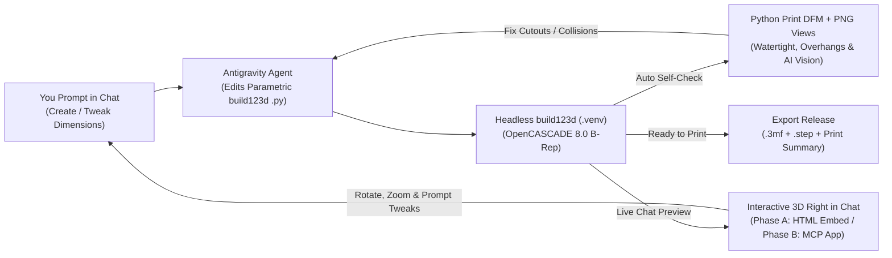
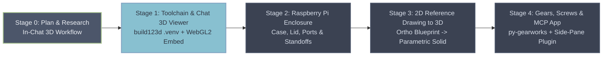

# <span style="color: #88C0D0;">**In-Chat Headless AI 3D-Printing CAD Plan**</span>

### <span style="color: #81A1C1;">**Filename:** `overall.md`</span>

| <span style="color: #EBCB8B;">**Field**</span> | <span style="color: #EBCB8B;">**Details**</span> |
| :--- | :--- |
| <span style="color: #EBCB8B;">**Author**</span> | devilsu |
| <span style="color: #EBCB8B;">**Created**</span> | 2026-11-20 PST |
| <span style="color: #EBCB8B;">**Modified**</span> | 2026-11-27 PST |
| <span style="color: #EBCB8B;">**Version**</span> | v4.0.0 |
| <span style="color: #EBCB8B;">**Host / Mode**</span> | `Ubuntu 26.04.1 LTS` / `Python 3.14.4` (100% Headless — Antigravity Desktop & Remote Control) |
| <span style="color: #EBCB8B;">**Desired UX**</span> | Prompt in Chat -> Rotate/Zoom 3D Right Inside Chat -> Prompt Tweaks -> Export `.3mf`/`.step` (Never Open CAD GUI) |
| <span style="color: #EBCB8B;">**Reference Template**</span> | [`learn_AI_PCB_design`](https://github.com/DevilSu/learn_AI_PCB_design) |
| <span style="color: #EBCB8B;">**Supporting Research**</span> | [8-Tool CAD Survey](research/cad_software_landscape_3dp.md) / [CAD MCP Analysis](research/cad_mcp_pros_cons_concerns.md) / [Project Diary](diary.md) |
| <span style="color: #EBCB8B;">**Status**</span> | <span style="color: #A3BE8C;">**Locked v4.0.0 — Executing Phase 1 (`toolchain_setup`)**</span> |

---

## <span style="color: #88C0D0;">**Table of Contents**</span>
- [<span style="color: #88C0D0;">**1. Single-Engine Headless Architecture**</span>](#1-single-engine-headless-architecture)
  - [<span style="color: #81A1C1;">1.1 Why Pure build123d Plus In-Chat 3D Viewer</span>](#11-why-pure-build123d-plus-in-chat-3d-viewer)
  - [<span style="color: #81A1C1;">1.2 Zero-Sudo Python Toolchain Breakdown</span>](#12-zero-sudo-python-toolchain-breakdown)
- [<span style="color: #88C0D0;">**2. In-Chat Interactive 3D Loop**</span>](#2-in-chat-interactive-3d-loop)
  - [<span style="color: #81A1C1;">2.1 Prompt-to-3D Dataflow</span>](#21-prompt-to-3d-dataflow)
  - [<span style="color: #81A1C1;">2.2 Phase A Inline Embed vs Phase B MCP App Upgrade</span>](#22-phase-a-inline-embed-vs-phase-b-mcp-app-upgrade)
- [<span style="color: #88C0D0;">**3. Progressive Subproject Roadmap**</span>](#3-progressive-subproject-roadmap)
  - [<span style="color: #81A1C1;">3.1 Multi-Stage Progression</span>](#31-multi-stage-progression)
  - [<span style="color: #81A1C1;">3.2 Subproject Scope Breakdown</span>](#32-subproject-scope-breakdown)
- [<span style="color: #88C0D0;">**4. Tripartite Repository Layout**</span>](#4-tripartite-repository-layout)

---

## <span style="color: #88C0D0;">**1. Single-Engine Headless Architecture**</span>

### <span style="color: #81A1C1;">**1.1 Why Pure build123d Plus In-Chat 3D Viewer**</span>

Because the target workflow is <span style="color: #EBCB8B;">**prompt in chat -> spin/zoom the 3D object right inside the chat -> prompt tweaks -> print (without ever opening external CAD software)**</span>, we drop `SolidCraft`, drop VS Code extensions (`o3dv-viewer` / `ocp-cad-viewer`), and drop all FEA/CNC bloat in favor of a single, zero-`sudo`, 100% Python headless stack:

* <span style="color: #EBCB8B;">**Single Headless B-Rep Engine (`build123d` on OpenCASCADE 8.0):**</span> Clean, deterministic Python `@dataclass` + `BuildPart` scripts (`extrude`, `revolve`, `fillet`, `chamfer`, `Mode.SUBTRACT`) that diff cleanly per chat prompt, export real `.3mf` (for slicing) + `.step` (exact CAD archive), and extend naturally to Stage 4 gears/screws (`py-gearworks` + `bd-warehouse`).
* <span style="color: #EBCB8B;">**Native In-Chat Interactive 3D (`<agent-embed>` -> MCP App):**</span> Every build automatically outputs a CSP-safe, zero-CDN, single-file WebGL2 3D viewer (`sw/common/export_chat_3d.py`, with automatic Canvas2D fallback) rendered **inline inside the Antigravity chat response** (drag to rotate, scroll/`+`/`-` to zoom, `Iso`/`Top`/`Front`/`Side` presets, per-part show/hide, X-Ray, and live Z cross-section clipping slider). Works identically on Antigravity Desktop and **Antigravity Remote Control** from any browser.
* <span style="color: #EBCB8B;">**Automated AI Self-Audit & 3D-Print DFM (Zero `sudo`):**</span> Because the AI agent inspects static images while you spin the interactive 3D widget, `sw/common/print_audit.py` + `sw/common/render_audit.py` automatically render headless multi-angle + cross-section PNGs for AI vision inspection and verify watertightness (`trimesh`/`manifold3d`), zero part collision (`intersect().volume == 0`), overhang angles (`> 45 deg`), bed fit, and filament mass in grams. *(Optional host add-on: `sudo apt install prusa-slicer` if CLI `.gcode` slicing is desired later.)*

### <span style="color: #81A1C1;">**1.2 Zero-Sudo Python Toolchain Breakdown**</span>

| <span style="color: #EBCB8B;">**Component**</span> | <span style="color: #EBCB8B;">**Install Source**</span> | <span style="color: #EBCB8B;">**Role in Pipeline**</span> |
| :--- | :--- | :--- |
| <span style="color: #EBCB8B;">**`build123d` (`cadquery-ocp` 8.0)**</span> | `Python 3.14` `.venv` (`pip`) | Parametric B-Rep modeling, solid collision proofs, `.3mf` & `.step` export |
| <span style="color: #EBCB8B;">**`trimesh` + `manifold3d`**</span> | `Python 3.14` `.venv` (`pip`) | Watertight manifold checks, overhang angle DFM audit, `.3mf`/`.stl` volume & filament grams |
| <span style="color: #EBCB8B;">**`matplotlib` + `Pillow`**</span> | `Python 3.14` `.venv` (`pip`) | Headless multi-angle 3D + 2D cross-section PNG renders for AI visual self-check (zero `sudo`) |
| <span style="color: #EBCB8B;">**`sw/common/export_chat_3d.py`**</span> | Repo Utility (`WebGL2` + `Canvas2D` fallback) | Zero-CDN offline single-file HTML 3D viewer embedded inline in chat via `<agent-embed>` |
| <span style="color: #EBCB8B;">**Optional: `prusa-slicer` CLI**</span> | User Shell `sudo apt install prusa-slicer` | Optional final `.gcode` slice & print-time estimate |

---

## <span style="color: #88C0D0;">**2. In-Chat Interactive 3D Loop**</span>

### <span style="color: #81A1C1;">**2.1 Prompt-to-3D Dataflow**</span>



Every mating feature (board pocket, `M2.5`/`M3` screw holes, snap-fit lid lip) applies explicit 3D-print radial clearances ($c_{\text{clearance}}$, typically `0.15–0.25 mm`) rather than zero-clearance nominal geometry:

$$
D_{\text{print}} = D_{\text{nominal}} + 2 c_{\text{clearance}}
$$

### <span style="color: #81A1C1;">**2.2 Phase A Inline Embed vs Phase B MCP App Upgrade**</span>

| <span style="color: #EBCB8B;">**Capability**</span> | <span style="color: #EBCB8B;">**Phase A: Inline `<agent-embed>` HTML (Stage 1)**</span> | <span style="color: #EBCB8B;">**Phase B: Antigravity CAD MCP App (Stage 4 Upgrade)**</span> |
| :--- | :--- | :--- |
| <span style="color: #EBCB8B;">**Setup**</span> | Zero plugins (`sw/common/export_chat_3d.py`) | Local plugin (`~/.gemini/config/plugins/cad-viewer/`) |
| <span style="color: #EBCB8B;">**Display**</span> | Inline `<= 420px` WebGL2 canvas inside each chat bubble + 1-click Side Panel expand | Inline or persistent Side Panel (`aux_pane`) updating in place |
| <span style="color: #EBCB8B;">**Best Mesh Size**</span> | Fast & clean for enclosures, brackets, and reference parts (`< 50k` triangles) | Streams dense Stage 4 gear/thread meshes via app-only `get_mesh` tool |
| <span style="color: #EBCB8B;">**Interaction**</span> | Orbit, zoom, pan, `Iso`/`Top`/`Front`/`Side`, part toggles, X-Ray, Z slice slider | Adds click-to-attach selection/measurements back to next chat prompt |

---

## <span style="color: #88C0D0;">**3. Progressive Subproject Roadmap**</span>

### <span style="color: #81A1C1;">**3.1 Multi-Stage Progression**</span>



### <span style="color: #81A1C1;">**3.2 Subproject Scope Breakdown**</span>

| <span style="color: #EBCB8B;">**Stage**</span> | <span style="color: #EBCB8B;">**Subproject**</span> | <span style="color: #EBCB8B;">**Goal & Learning Focus**</span> | <span style="color: #EBCB8B;">**Status**</span> |
| :---: | :--- | :--- | :---: |
| <span style="color: #EBCB8B;">**Stage 0**</span> | **`plan_and_research`** | Ecosystem & MCP comparisons plus this locked `v4.0.0` in-chat 3D plan. | <span style="color: #A3BE8C;">**Completed**</span> |
| <span style="color: #EBCB8B;">**Stage 1**</span> | **`toolchain_setup`** | Scaffold tripartite repo (`RULE-REPO-001`), build `.venv` (`build123d`, `trimesh`, `manifold3d`, `matplotlib`, `Pillow`), create `export_chat_3d.py` + `print_audit.py` + `render_audit.py`, and run a live in-chat 3D smoke test. | <span style="color: #88C0D0;">**In Progress**</span> |
| <span style="color: #EBCB8B;">**Stage 2**</span> | **`rpi_enclosure`** | Simple 3D-printed Raspberry Pi case + lid (`M2.5` standoffs, USB/Ethernet/HDMI/USB-C cutouts, vent slots, rounded corners, lip/snap-fit)—iterated purely via chat prompts + inline 3D spin. | <span style="color: #4C566A;">**Planned**</span> |
| <span style="color: #EBCB8B;">**Stage 3**</span> | **`reference_drawing_to_3d`** | Feed dimensioned 2D orthographic drawings/sketches into chat, extract datums and cutouts, generate the parametric 3D solid, and inspect interactively in chat + ortho overlays. | <span style="color: #4C566A;">**Planned**</span> |
| <span style="color: #EBCB8B;">**Stage 4**</span> | **`gears_and_screws`** | Add `py-gearworks` + `bd-warehouse` for printable nuts/bolts and involute/planetary/worm gears with FDM `backlash`, plus optional Phase B Antigravity CAD MCP App side-pane upgrade. | <span style="color: #4C566A;">**Planned**</span> |

---

## <span style="color: #88C0D0;">**4. Tripartite Repository Layout**</span>

Adhering strictly to `RULE-REPO-001`, `RULE-EVID-001`, and `RULE-DIARY-001`:

```text
learn_AI_CAD_design/
├── readme.md                                       # Master project guide & roadmap dashboard
├── .gitignore                                      # Python .venv, G-code & scratch rules
├── blueprints/
│   ├── overall.md                                  # Locked v4.0.0 in-chat 3D architecture plan
│   ├── diary.md                                    # Append-only daily engineering journal
│   ├── research/                                   # 8-tool CAD landscape & MCP trade-off docs
│   ├── toolchain_setup/                            # Stage 1: phase_1.md + backup_evidences.md
│   ├── rpi_enclosure/                              # Stage 2 (Planned): Raspberry Pi case & lid
│   ├── reference_drawing_to_3d/                    # Stage 3 (Planned): 2D drawing -> 3D solid
│   └── gears_and_screws/                           # Stage 4 (Planned): Gears, threads & MCP App
├── hw/
│   ├── common/                                     # Shared 3D-print tolerance profiles & board refs
│   └── subprojects/                                # Isolated per-stage .3mf, .step & PNG exports
└── sw/
    ├── common/                                     # setup_env.sh, requirements.txt, export_chat_3d.py, print_audit.py
    └── subprojects/                                # Isolated per-stage parametric build123d scripts & tests
```
