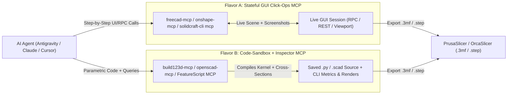

# **MCP-Controlled CAD for 3D Printing: Pros, Cons, Limitations & Hidden Traps**

### **Filename:** `cad_mcp_pros_cons_concerns.md`

| **Field** | **Details** |
| :--- | :--- |
| **Scope** | CAD Model Context Protocol (`MCP`) Servers vs. Direct Code Execution |
| **Host Verified** | `Ubuntu 26.04.1 LTS` / `Python 3.14.4` (Live PyPI Metadata Checked) |
| **Target Workload** | 3D Printing (`.3mf` / `.stl` / `.step`) + Gears & Printable Screw Threads |
| **Status** | **Completed Research Reference (Locked on Tier 1)** |

---

## **Table of Contents**
- [**1. Yes, CAD Can Be Controlled by MCP in Two Ways**](#1-yes-cad-can-be-controlled-by-mcp-in-two-ways)
- [**2. Per-Software MCP Breakdown: Pros, Cons & Traps**](#2-per-software-mcp-breakdown-pros-cons--traps)
  - [2.1 freecad-mcp (v0.1.32) + FreeCAD 1.0 / 1.1](#21-freecad-mcp-v0132--freecad-10--11)
  - [2.2 onshape-mcp (v0.1.0) & Onshape FeatureScript MCP](#22-onshape-mcp-v010--onshape-featurescript-mcp)
  - [2.3 SolidCraft (solidcraft-cli mcp)](#23-solidcraft-solidcraft-cli-mcp)
  - [2.4 build123d-mcp (v0.3.91) — Plus the agentcad Python 3.14 Trap](#24-build123d-mcp-v0391--plus-the-agentcad-python-314-trap)
  - [2.5 openscad-mcp (v0.6.1) + OpenSCAD (Manifold) + BOSL2](#25-openscad-mcp-v061--openscad-manifold--bosl2)
  - [2.6 fusion360-mcp & blender-mcp (Why Excluded)](#26-fusion360-mcp--blender-mcp-why-excluded)
- [**3. Side-by-Side CAD MCP Comparison Matrix**](#3-side-by-side-cad-mcp-comparison-matrix)
- [**4. Four Universal Limitations of CAD MCP**](#4-four-universal-limitations-of-cad-mcp)
- [**5. Bottom-Line Selection for Headless Remote-SSH Workflow**](#5-bottom-line-selection-for-headless-remote-ssh-workflow)

---

## **1. Yes, CAD Can Be Controlled by MCP in Two Ways**

**Yes — almost every major CAD system now has an MCP server**, and driving CAD via MCP fits naturally alongside an Antigravity workflow. However, CAD MCP servers fall into **two fundamentally different architectures**, and picking the wrong flavor creates severe reliability, quota, or latency headaches:

* **Flavor A — Stateful "GUI Click-Ops" RPC MCP** (`freecad-mcp` UI tools, `onshape-mcp` REST UI wrappers, `solidcraft-cli mcp`, `fusion360-mcp`): The AI sends sequential commands (`create_sketch` -> `draw_circle` -> `extrude` -> `fillet` -> `get_view`) into an active GUI session or cloud workspace over RPC/REST.
* **Flavor B — "Code-Sandbox + Visual Inspector" MCP** (`build123d-mcp`, `openscad-mcp`, Onshape's `FeatureScript MCP`, `freecad-mcp`'s `execute_code`): The AI writes parametric code (`.py`, `.scad`, or `FeatureScript`) into a persistent MCP runner that compiles the geometry kernel, measures bounding boxes/clearances, renders multi-view PNGs, and returns exact stack traces—while keeping deterministic source code in Git.

---

## **2. Per-Software MCP Breakdown: Pros, Cons & Traps**

### **2.1 `freecad-mcp` (`v0.1.32`) + FreeCAD 1.0 / 1.1**

* **How It Works:** A FreeCAD workbench addon (`FreeCADMCP`) opens a local RPC socket on `127.0.0.1:9875`, and `freecad-mcp` (`v0.1.32`, `Python >=3.12`) bridges MCP calls (`create_document`, `create_object`, `execute_code`, `get_view`) into the running FreeCAD window.
* **Pros:** 100% free, local, and private; live desktop GUI right alongside AI edits (`get_view` feedback); access to FreeCAD's `FCGear` and `Fasteners` workbenches; exports true `.step` and `.3mf`.
* **Cons & Concerns:**
  1. **Ubuntu 26.04 Setup & Always-Open GUI Friction:** `freecad` is absent from Ubuntu 26.04 `apt`, so you must run an AppImage or Snap, manually install the internal `FreeCADMCP` workbench addon, and keep a desktop GUI open whenever MCP runs (poor fit for headless Remote-SSH).
  2. **Main-Thread GUI Freezes:** Heavy helical thread booleans or large gear arrays block FreeCAD's Qt main thread, hanging the RPC server until you manually kill and restart FreeCAD.
  3. **API Hallucination & TopoNaming Fragility:** FreeCAD's massive stateful Python workbench API breaks far more easily under LLM edits than `build123d` or `BOSL2`, and downstream face/edge references (`Face14`) can still break when upstream parameters shift.
  4. **Local RCE Surface:** `execute_code` runs arbitrary Python inside FreeCAD over port `9875`; it must never be bound outside `127.0.0.1`.

### **2.2 `onshape-mcp` (`v0.1.0`) & Onshape FeatureScript MCP**

* **How It Works:** Connects Antigravity via REST API / OAuth (`altendky/onshape-mcp`, `navipilot/onshape-mcp`, `hedless/onshape-mcp`) or Onshape's `FeatureScript MCP` (`fs-mcp.labs.onshape.app`) to drive browser Part Studios, inject `FeatureScript` (such as *Kochlias* threads or involute gear scripts), pull PNG views, and export `.step`/`.3mf`/`.stl`.
* **Pros:** Zero local CAD installation (runs natively in Chrome/Firefox WebGL); world-class Parasolid fillets; live browser **Gear Relation** animations; native parametric timelines.
* **Cons & Concerns:**
  1. **Severe Annual API Quota Trap (`2,500 calls/year` Free):** Onshape enforces rigid annual REST API limits (`2,500 calls/year` on Free/Student accounts, `5,000/year` on Professional, `10,000/year` on Enterprise), plus per-minute `HTTP 429` throttling. An iterative MCP loop calling sketch, extrude, metadata query, multi-view render, retry, and export tools can **burn an entire year's API quota in days**. *(Internal `FeatureScript` execution inside Onshape avoids external call counts, though fetching views/exports still costs API calls.)*
  2. **Zero Privacy on Free Tier:** Every Free-tier document is 100% public and searchable worldwide.
  3. **Transient ID Fragility:** Granular REST sketch/extrude chains fail easily when upstream edits change Onshape transient face IDs (`btTypes`).

### **2.3 SolidCraft (`solidcraft-cli mcp`)**

* **How It Works:** Open-source Rust parametric CAD (`tangency-labs/solidcraft`, `MIT` / `Apache-2.0`) with a native `egui`/`wgpu` Linux GUI, WASM browser build, and a **first-party built-in MCP server (`solidcraft-cli mcp`)** that edits feature timelines, measures parts, grabs screenshots, and exports `.step` (`AP242`), `.3mf`, and `.stl`.
* **Pros:** Zero Python/Java glue or third-party MCP bridges needed; works either headlessly or synced live to the desktop GUI; 100% local, open-source, and private.
* **Cons & Concerns:**
  1. **Early-Kernel Fillet & Thread Bugs (2026):** Transitioning from `truck` to `solidcore`, SolidCraft still hits documented multi-minute hangs and `SMLib` failures on multi-edge blends—and **explicit bugs where adding a modeled thread causes unrelated fillets on the same body to fail**.
  2. **No Gear or Printable-Thread Library:** Lacks a `py-gearworks` or `BOSL2` equivalent today, making parametric involute/herringbone/worm gear trains fragile to generate reliably.

### **2.4 `build123d-mcp` (`v0.3.91`) — Plus the `agentcad` Python 3.14 Trap**

* **How It Works:** `build123d-mcp` (`@casys/mcp-build123d`, `v0.3.91`) wraps `build123d` (`0.13.0`) in a persistent Python MCP sandbox where the agent calls `show()`, queries exact volumes, bounding boxes, minimum clearances, and cross-sections, renders views, and exports `.step` + `.3mf`. Live PyPI inspection confirmed **`build123d-mcp 0.3.91` supports `Python 3.14` natively (`<3.15,>=3.11`)**—whereas the popular alternative **`agentcad 0.8.0` currently pins `Python <3.13`** and will fail on Ubuntu 26.04's system `Python 3.14.4`!
* **Pros:** 100% local & headless with zero API quotas; native `Python 3.14` wheels; true OpenCASCADE B-Rep `.step` + `.3mf` output; direct KiCad `.step` PCB import for enclosures; full access to `py-gearworks` (`0.0.24`, involute spur/helical/bevel/ring/planetary/cycloid gears) and `bd-warehouse` (`0.4.0`, worm/rack/spur/helical gears + printable ISO/Acme/trapezoidal/bottle threads); pairs directly with Antigravity WebGL tabs (`o3dv-viewer` + `OCP CAD Viewer`) for 3D orbit/zoom over Remote-SSH.
* **Cons & Concerns:**
  1. **No Direct Mouse Sketch-Dragging Inside the Tool:** You can rotate/zoom/slice in Antigravity (`ocp-cad-viewer` / `o3dv-viewer`) or open `.step` exports in external CAD, but geometry edits happen through code/AI rather than dragging sketch handles.
  2. **OpenCASCADE Fillet Ordering (`StdFail_NotDone`):** Applying fillets larger than adjacent faces or filleting before boolean cuts triggers kernel crashes that the AI must catch and reorder.
  3. **Token Consumption on Visual Loops:** Repeatedly running code, generating cross-sections, and inspecting PNG renders uses more tokens/time than one-shot text scripts.

### **2.5 `openscad-mcp` (`v0.6.1`) + OpenSCAD (`Manifold`) + `BOSL2`**

* **How It Works:** Verified compatible with `Python 3.14` (`>=3.10`), `openscad-mcp` exposes MCP tools to write, render, measure, check assemblies, extract features, judge printability, and export `.3mf`/`.stl` using `OPENSCAD_PATH`.
* **Pros:** Highest one-shot LLM coding accuracy; paired with `BOSL2` (`gears.scad`, `threading.scad`, `screws.scad`), it gives a rich catalog of spur, helical, herringbone, bevel, and worm gears plus multi-start, Acme, bottle, and metric screws with built-in `backlash` and `$slop` clearance parameters; 100% local and unlimited.
* **Cons & Concerns:**
  1. **Ubuntu 26.04 APT CGAL Slowdown Trap:** If `OPENSCAD_PATH` points to Ubuntu `apt`'s legacy `openscad 2021.01-11` (old CGAL backend), helical screws and herringbone gears can take minutes and time out MCP calls. You must point it to a modern **OpenSCAD `Manifold` AppImage/Snap**, which compiles in sub-second runs.
  2. **Polygon Mesh Ceiling:** Exports triangulated `.3mf`/`.stl` only—**cannot export `.step`** for downstream GUI CAD edits and cannot natively import KiCad `.step` PCBs for enclosure alignment.

### **2.6 `fusion360-mcp` & `blender-mcp` (Why Excluded)**

* **Autodesk Fusion MCP:** Local HTTP MCP requires Windows or macOS desktop Fusion (no native Linux client; `wine` is absent), while cloud Fusion Compute MCP lacks a native Linux GUI.
* **`blender-mcp` (`Blender 5.0`):** Runs natively via `apt` (`5.0.1`), but Blender is a mesh/animation tool lacking parametric engineering sketches, involute backlash math, and B-Rep `.step` precision.

---

## **3. Side-by-Side CAD MCP Comparison Matrix**

| **MCP Server** | **Ubuntu 26.04 / Py 3.14** | **Headless Remote-SSH?** | **API Quotas / Privacy** | **Gear & Screw Depth** | **`.step` Support** | **Primary Failure Mode / Risk** |
| :--- | :--- | :---: | :--- | :--- | :---: | :--- |
| **`build123d-mcp` (`0.3.91`)** *(Selected — Tier 1)* | **Native (`<3.15`)** *(Avoid `agentcad <3.13`)* | **Yes (100%)** (+ Antigravity WebGL 3D tabs) | Unlimited / 100% Private | **Complete** (`py-gearworks` + `bd-warehouse`) | **Yes** | OpenCASCADE fillet ordering crashes (`StdFail_NotDone`); no drag-sketch GUI |
| **`openscad-mcp` (`0.6.1`)** | **Native (`>=3.10`)** *(Needs `Manifold` AppImage)* | **Yes** (with `xvfb`/CLI) | Unlimited / 100% Private | **Deepest** (`BOSL2` gears + threads + `$slop`) | **No** (Mesh only) | Legacy `apt` CGAL timeouts; no `.step` export or KiCad PCB `.step` import |
| **`freecad-mcp` (`0.1.32`)** | AppImage/Snap (`apt` missing) | **No** (Needs live GUI) | Unlimited / 100% Private | **Strong** (`FCGear` + `Fasteners`) | **Yes** | Qt main-thread hangs on heavy threads/gears; high API hallucination; port `9875` RCE risk |
| **`onshape-mcp` (`0.1.0`) / FS MCP** | Browser WebGL (`>=3.11`) | External Browser | **`2,500 calls/yr` Free; Public Models** | Good (*Kochlias* + Gear FS + Live Anim) | **Yes** | Exhausting annual API quota in days; `429` throttling; public IP exposure |
| **`solidcraft-cli mcp`** | Native Rust Linux App / CLI | CLI Headless / GUI | Unlimited / 100% Open Source | **Weak** (No gear lib yet) | **Yes** | Kernel fillet hangs + **modeled threads breaking fillets** (`truck`/`solidcore`) |
| **`fusion360-mcp`** | **No Linux App** | Windows/macOS / Cloud | 10 active docs (Free) | Spur add-in + manual thread offsets | **Yes** | Unsupported on Ubuntu desktop; Cloud Compute MCP lacks local GUI |

---

## **4. Four Universal Limitations of CAD MCP**

Regardless of which CAD software you connect, engineers consistently hit four structural limitations with MCP-controlled CAD—all solvable with disciplined guardrails:

1. **"Click-Ops" Token Bloat & Lost Reproducibility:** Creating a gearbox via 40–60 stateful GUI MCP tool calls consumes high token budgets, breaks mid-chain when a transient face ID changes, and leaves binary GUI state without clean Git diffs. **Fix:** Prefer Flavor B (executing clean, versioned `.py` scripts through MCP or CLI) so every part is 100% reproducible.
2. **Isometric Screenshot Blindness:** An AI looking only at exterior isometric MCP screenshots will declare victory on parts with **hidden internal defects**—colliding internal gear teeth, blind screw holes that bottom out before tightening, or snap-fits intersecting PCB headers. **Fix:** Mandate **2D mid-plane cross-section renders** plus programmatic `intersect().volume == 0` interference checks and Antigravity's `OCP CAD Viewer` section sliders.
3. **"Kernel-Valid" Does Not Mean "3D-Printable":** Every CAD MCP kernel reports `valid solid` on parts with `0.00 mm` welded bolt clearances, `90 deg` unsupported internal roofs, or `0.2 mm` gear teeth thinner than a `0.4 mm` printer nozzle. **Fix:** Always parameterize explicit FDM tolerances (`backlash`, flank clearance, `45 deg` chamfers) and validate exports through **headless `PrusaSlicer` (`2.9.4`) CLI slicing**.
4. **Antigravity Already Has Native Bash + Image Vision:** Unlike chat-only desktop apps (`Claude Desktop`) that *need* an MCP server just to run a command or see a PNG, Antigravity already runs `.venv` scripts natively via terminal and inspects rendered PNGs directly. That makes MCP a **nice-to-have interactive inspector**, not a single point of failure—if an MCP server ever lags or breaks, your underlying `.py` pipeline keeps running identically.

---

## **5. Bottom-Line Selection for Headless Remote-SSH Workflow**

As locked in [overall.md](../overall.md), this project standardizes on **Tier 1 (`Python 3.14`-only)**:

* **Primary Headless MCP Stack (`100% Local, Unlimited Calls, Zero X11 GUI`):** **`build123d-mcp` (`0.3.91`)** + `build123d` (`0.13.0`) + **`py-gearworks` (`0.0.24`)** + **`bd-warehouse` (`0.4.0`)** + headless **`PrusaSlicer 2.9.4` CLI**, paired with **`nahueltaibo.o3dv-viewer`** and **`ocp-cad-viewer`** inside Antigravity for 60 FPS Remote-SSH 3D rotation, zooming, and cross-section inspection.
* **Deferred Optional Fallback:** `openscad-mcp` + `BOSL2` stays out of the active stack to preserve single-language `.step` compatibility, and can be added later only if niche `BOSL2` presets (such as garden-hose or mason-jar threads) are ever required.
