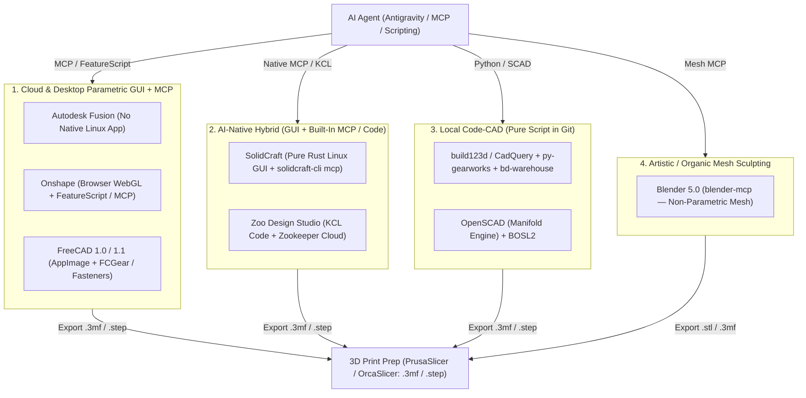

# **CAD Software Landscape: AI-Assisted 3D Printing, Gears & Screw Threads on Ubuntu**

### **Filename:** `cad_software_landscape_3dp.md`

| **Field** | **Details** |
| :--- | :--- |
| **Scope** | 8 Major GUI, Cloud, AI-Native & Code-CAD Platforms |
| **Primary Focus** | 3D Printing (`.3mf` / `.stl` / `.step`) + Gears & Printable Screw Threads |
| **Dropped Scope** | Zero Structural/Thermal FEA Simulation (`gmsh` / `calculix-ccx` removed), Zero CNC Bloat |
| **Host OS / Python** | `Ubuntu 26.04.1 LTS` (`snap` + `apt`, no `flatpak` or `wine`) / `Python 3.14.4` |
| **Status** | **Completed Research Reference (Locked on Tier 1)** |

---

## **Table of Contents**
- [**1. Full 8-Tool CAD Taxonomy for 3D Printing**](#1-full-8-tool-cad-taxonomy-for-3d-printing)
- [**2. Deep Dive: Fusion 360, Onshape, SolidCraft & Contenders**](#2-deep-dive-fusion-360-onshape-solidcraft--contenders)
  - [2.1 Autodesk Fusion (Fusion 360)](#21-autodesk-fusion-fusion-360)
  - [2.2 Onshape (Browser GUI + FeatureScript + MCP)](#22-onshape-browser-gui--featurescript--mcp)
  - [2.3 SolidCraft (Rust GUI + Built-In MCP)](#23-solidcraft-rust-gui--built-in-mcp)
  - [2.4 Zoo Design Studio (KCL) & FreeCAD 1.0 / 1.1](#24-zoo-design-studio-kcl--freecad-10--11)
  - [2.5 Local Code-CAD Powerhouses: build123d vs. OpenSCAD + BOSL2](#25-local-code-cad-powerhouses-build123d-vs-openscad--bosl2)
- [**3. Master 8-Tool Comparison Matrix**](#3-master-8-tool-comparison-matrix)
- [**4. AI Gear & Screw Design: Libraries & Print Tolerance Math**](#4-ai-gear--screw-design-libraries--print-tolerance-math)
- [**5. Three Practical Starting Paths & Updated Testbed Roadmap**](#5-three-practical-starting-paths--updated-testbed-roadmap)

---

## **1. Full 8-Tool CAD Taxonomy for 3D Printing**

Our first proposal omitted **Autodesk Fusion (Fusion 360)**, **Onshape**, and **SolidCraft** because it assumed the strict local-Python-only filter used in `learn_AI_PCB_design`. Stepping back, this comparison evaluates **all 8 major CAD ecosystems** against the five criteria that actually matter for your goals:

1. **Ubuntu 26.04 Linux Experience:** Native desktop/CLI/browser support versus unsupported Windows emulation.
2. **AI & Agent Reliability:** Maturity of MCP tool servers, FeatureScript generation, or Python/SCAD scripting accuracy.
3. **Gear & Screw/Thread Libraries:** Built-in involute spur, helical, herringbone, bevel, worm, and planetary gears with FDM `backlash`, plus ISO/Acme/Trapezoidal printable threads with flank clearances.
4. **3D-Printing & Enclosure Power:** Clean `45 deg` chamfers, rolling fillets, snap-fits, `.3mf`/`.step` slicer exports, and importing KiCad `.step` PCBs for custom enclosures.
5. **Interactive Mouse Editing, Privacy & Cost:** Ability to tweak geometry visually with a mouse, file privacy, and subscription limits.

---

## **2. Deep Dive: Fusion 360, Onshape, SolidCraft & Contenders**

### **2.1 Autodesk Fusion (Fusion 360)**

* **AI & Gear/Screw Support:** Autodesk offers a local **Fusion MCP** (Windows/macOS desktop HTTP), a cloud **Fusion Compute MCP** beta, and community TCP add-ins (`fusion360-mcp-server`). It includes a built-in `SpurGear` script and modeled thread features (though 3D-printable threads require manual `Offset Face` flank clearances).
* **Ubuntu 26.04 Verdict (Eliminated by Linux Friction):** Autodesk provides **no native Linux desktop client** (`wine` is not installed on this workstation, and Wine/Bottles wrappers frequently break across Autodesk WebView2 login updates). Running cloud-only Compute MCP without a native Linux timeline GUI removes Fusion's biggest advantage while keeping Personal Use's 10-active-document limit.

### **2.2 Onshape (Browser GUI + FeatureScript + MCP)**

* **Ubuntu & AI Ecosystem:** Runs natively in Chrome or Firefox via WebGL on Ubuntu 26.04 with zero local installation, backed by the industrial **Parasolid** kernel. AI agents connect through open-source MCP servers (`altendky/onshape-mcp`, `navipilot/onshape-mcp`, `hedless/onshape-mcp`, plus Onshape's `fs-mcp.labs.onshape.app`) that drive **FeatureScript**, capture multi-view PNG renders, and export `.step`/`.3mf`/`.stl`.
* **Gear & Screw Capabilities:** Community FeatureScripts like *Kochlias / ThreadLab* add 3D-printing flank offsets and multi-start threads, while *Spur/Helical Gear* FeatureScripts pair with Onshape's native **Gear Relation** assembly mates—letting you visually spin and test meshing gear trains in the browser.
* **The Two Catches:** (1) Onshape's Free Plan makes **100% of your designs public and searchable** worldwide (private documents require a paid commercial plan), and (2) models live in Onshape's cloud rather than offline Git repositories.

### **2.3 SolidCraft (Rust GUI + Built-In MCP)**

* **Ubuntu & AI Ecosystem:** Open-source (`MIT` / `Apache-2.0`, `tangency-labs/solidcraft`) parametric CAD written in pure Rust, shipping a native Linux desktop GUI (`egui`/`wgpu`), WASM web app, and headless CLI with a **first-party built-in MCP server (`solidcraft-cli mcp`)**. AI agents build feature timelines, inspect dimensions, grab viewport renders, and export `.step` (`AP242`), `.3mf`, and `.stl`.
* **Critical Caveat for Gears & Screws (2026):** SolidCraft's geometry kernels (transitioning from `truck` to `solidcore`) still have documented **fillet/blend failures, long compute hangs on multi-edge intersections, and explicit bugs where adding a modeled thread causes subsequent fillets on the same body to fail**. It also lacks a mature involute gear library (`BOSL2` or `py-gearworks` equivalent). Great to track or install as a secondary GUI/MCP sandbox, risky as your primary screw/gear workhorse today.

### **2.4 Zoo Design Studio (KCL) & FreeCAD 1.0 / 1.1**

* **Zoo Design Studio (`KCL`):** Ships an official native Linux desktop app where mouse modeling and its *Zookeeper* AI sync bidirectionally into open-source `KCL` code (`STEP`/`STL`/`glTF` export). However, geometry/AI reasoning runs on Zoo's cloud with a metered monthly free allotment and lacks a deep gear/printable-thread warehouse today.
* **FreeCAD (`1.0` / `1.1` AppImage + `freecad-mcp`):** FreeCAD `1.0` resolved the historic Topological Naming Problem and ships strong GUI add-ons for 3D printing—**`FCGear`** (spur, helical, herringbone, bevel, worm, cycloidal) and **`Fasteners`** (including a 3D-print thread clearance scale setting). Because FreeCAD's massive, stateful Python sketcher API makes LLMs prone to constraint errors, it shines as a **free local GUI viewer/editor for `.step` parts** generated by AI rather than as the primary AI code target.

### **2.5 Local Code-CAD Powerhouses: build123d vs. OpenSCAD + BOSL2**

* **`build123d` + `bd-warehouse` + `py-gearworks` (+ `ocp-vscode`):** Verified native `Python 3.14` PyPI wheels (`build123d 0.13.0`, `cadquery-ocp 8.0.1.1.0`, `bd-warehouse 0.4.0`, `py-gearworks 0.0.24`). Uses the OpenCASCADE B-Rep kernel for exact rolling-ball fillets, true `.step` + `.3mf` export, and direct KiCad `.step` PCB imports. `bd-warehouse` provides ISO, Acme, trapezoidal, and plastic-bottle threads (`simple=False` for printable physical threads, alongside community `123DScrew` print-flank patterns) plus `SpurGear`, `HelicalGear`, `RackGear`, `Worm` / `WormWheel` / `WormGear`, and `Sprocket`, while `py-gearworks` generates parametric involute spur, helical, bevel, internal ring, cycloidal, and planetary gears with profile shifts and backlash clearance.
* **`OpenSCAD` (Manifold Engine) + `BOSL2`:** Equipped with **`BOSL2`** (`gears.scad`, `threading.scad`, `screws.scad`), OpenSCAD offers arguably the deepest 3D-printing gear & thread catalog available—spur, helical, self-centering **herringbone**, bevel, **worm drives**, racks, multi-start lead screws, Acme, metric, bottle, and hose threads with built-in `backlash` and `$slop` printer-clearance variables, plus top one-shot LLM coding accuracy. **Catches:** Polygon-mesh only (`.3mf`/`.stl` — **no `.step` export** and cannot import KiCad `.step` PCBs), and you should use a modern `Manifold`-enabled AppImage/Snap rather than Ubuntu `apt`'s legacy `2021.01-11` CGAL build.

---

## **3. Master 8-Tool Comparison Matrix**

| **CAD Platform** | **Workflow** | **Ubuntu 26.04 UX** | **AI Reliability** | **Gear Capabilities** | **3D-Print Screws & Threads** | **Fillets & KiCad `.step` Enclosures** | **Privacy & Cost** |
| :--- | :--- | :--- | :--- | :--- | :--- | :--- | :--- |
| **`build123d` + `py-gearworks` + `bd-warehouse`** | Python B-Rep Code + In-IDE Viewer | Native `.venv` (`cp314` wheels) | **High** (Python + B-Rep error checks) | Spur, helical, bevel, ring, planetary, cycloid, worm (`py-gearworks` + `bd-warehouse`) | ISO, Acme, trapezoidal, bottle (`bd-warehouse` / `123DScrew`) | **Excellent** (True NURBS `.step` + direct PCB `.step` import) | 100% Free, Local & Private |
| **`OpenSCAD` (`Manifold`) + `BOSL2`** | CSG Script + GUI Preview | Native AppImage / Snap (`Manifold`) | **Very High** (Simplest LLM syntax) | Spur, helical, herringbone, bevel, **worm**, racks (`gears.scad`) | Deepest catalog + built-in `backlash` & `$slop` (`threading.scad`) | Mesh only (`.3mf`/`.stl`, **no `.step`**, hard to chamfer organic seams) | 100% Free, Local & Private |
| **Onshape + MCP + FeatureScript** | Cloud GUI + Code Dialogs | Smooth Browser WebGL | **High** (FeatureScript + visual PNG MCP) | Spur, helical, ring + **live Gear Relation assembly animation** | *Kochlias / ThreadLab* FeatureScripts (custom flank clearance) | **Best-in-Class** (Parasolid fillets + `.step`/`.3mf`) | Free = **100% Public**; Private = Paid |
| **FreeCAD `1.0` / `1.1`** | Local Desktop GUI + Python | AppImage / Snap (`apt` candidate missing) | Low–Moderate (Complex stateful API) | Strong via `FCGear` workbench (spur, helical, worm, bevel) | Strong via `Fasteners` workbench (3D-print clearance factor) | Strong local `.step` viewer/editor for hand touch-ups | 100% Free, Local & Private |
| **SolidCraft (`tangency-labs`)** | Rust GUI + `solidcraft-cli mcp` | Native Linux `egui` / WASM | **Promising** (Built-in MCP & viewport inspect) | No mature involute gear library yet | Modeled threads exist, but **documented thread + fillet kernel bugs** | Young kernel (`solidcore`) still hits complex fillet hangs/errors | 100% Open Source (`MIT`/`Apache-2.0`) |
| **Zoo Design Studio (`KCL`)** | Hybrid GUI + `KCL` + AI | Native Linux Desktop App | Moderate–High (*Zookeeper* + KCL) | Manual/custom KCL equations (no standard gear warehouse) | Manual/custom KCL helix sweeps | Clean B-Rep `.step`/`.stl`, cloud geometry engine | Free tier metered monthly AI/API |
| **Autodesk Fusion** | Proprietary Desktop GUI + MCP | **No Linux App** (No `wine` installed) | High (Windows/macOS or Cloud MCP) | Built-in `SpurGear` add-in | Modeled ISO/ANSI (manual flank offset needed) | Industry-grade on Windows/macOS, unusable natively here | Free = 10 active docs; Windows/macOS |
| **Blender `5.0` (`apt`)** | Mesh Modeling + `blender-mcp` | Native `apt` (`5.0.1`) | Moderate (Good for scenes, weak CAD) | Add-on meshes only (non-engineering) | Fragile mesh booleans | No B-Rep `.step` precision or parametric sketches | 100% Free, Local & Private |

---

## **4. AI Gear & Screw Design: Libraries & Print Tolerance Math**

Removing all structural/thermal FEA (`gmsh`, `calculix-ccx`) and CNC checks leaves a focused **3D-printing-only engineering loop**. Crucially, AI agents should **never hand-derive involute tooth splines or helical thread sweeps from raw polygons**—instead, they parameterize validated libraries (`py-gearworks`, `bd-warehouse`, `BOSL2`, or *ThreadLab*) and enforce deterministic print tolerances:

1. **Gear Pair Center Distance with FDM Backlash & Fit Offset:** For module $m$ and tooth counts $z_1, z_2$, Python/`BOSL2` computes exact shaft spacing plus an empirically calibrated radial offset $\Delta a_{\text{clearance}}$ (alongside tooth `backlash` thinning) so `0.4 mm` nozzle perimeters do not bind:

$$
a_{\text{center}} = \frac{m \left(z_1 + z_2\right)}{2} + \Delta a_{\text{clearance}}
$$

2. **3D-Printed Internal Thread Clearance & Flank Geometry:** Standard `60 deg` triangular ISO threads often droop or fuse on FDM overhangs below `M8`. For printed mechanical screws, the workflow defaults to **`45 deg`–`60 deg` stub/trapezoidal profiles** (printable horizontally or vertically without supports) and applies explicit flank clearance $c_{\text{flank}}$ between external bolts and internal nuts:

$$
D_{\text{nut,print}} = D_{\text{bolt,nominal}} + 2 c_{\text{flank}}
$$

3. **Lean 3D-Print Pre-Flight Checklist (Zero FEA):**
   * **Printability Rules:** `45 deg` bed-side chamfers (instead of overhanging bottom fillets), walls sized as integer multiples of nozzle line width (`0.4 mm` / `0.8 mm` / `1.6 mm`), and verified non-zero clearance on mating parts (`part_a.intersect(part_b).volume == 0.0` in `build123d`).
   * **Visual Cross-Section Check:** Automated 2D mid-plane cross-sections + multi-angle 3D PNG renders (`f3d` / `OpenSCAD` / `Onshape`) before touching the printer.
   * **Headless Slicer Check (`prusa-slicer 2.9.4` or `OrcaSlicer`):** Slice exported `.3mf`/`.step` via CLI to verify watertight manifold geometry, bed fit, support volume, and print time/filament usage.

---

## **5. Three Practical Starting Paths & Updated Testbed Roadmap**

Based on the full 8-tool comparison, here were the **three candidate paths** evaluated before locking **Tier 1 (Option B)** in [overall.md](../overall.md):

| **Option** | **Toolchain Stack** | **Why Pick This Path** | **Trade-Off** |
| :--- | :--- | :--- | :--- |
| **Option A: Local Dual-Engine** *(Optional Future Add-On)* | `build123d` + `py-gearworks` + `bd-warehouse` + `OpenSCAD (Manifold)` + `BOSL2` + `PrusaSlicer` CLI | Covers both `.step` PCB enclosures and `BOSL2` preset hose/bottle/dovetail helpers | Maintains two code syntaxes (`Python` + `.scad`) and an extra AppImage/Snap |
| **Option B: Single Unified Python Stack** *(Selected — Tier 1)* | **`build123d` + `py-gearworks` + `bd-warehouse` + `ocp-vscode`** + `f3d` + **`PrusaSlicer`** CLI | Pure `Python 3.14` `.venv` mirroring `learn_AI_PCB_design` (`~430 MB` total); handles `.3mf`/`.step`, spur/helical/bevel/ring/planetary/worm gears, ISO/Acme/trapezoidal threads, and KiCad `.step` imports in one language | Niche `BOSL2` presets (garden-hose/mason-jar) stay deferred unless ever needed |
| **Option C: Browser GUI + MCP First** | **Onshape** (Browser GUI + *Kochlias* & Gear FeatureScripts) + `onshape-mcp` + `PrusaSlicer` | Best interactive mouse sketching, Parasolid fillets, and **live browser gear-train animation** | **All Free-plan models are public**; `2,500 calls/yr` API cap; leaves Antigravity Remote-SSH |

### **Selected 3D-Printing + Gear/Screw Testbed Roadmap**

* **Stage 0 (`research` / `overall.md`):** Ecosystem comparison, 3D-print tolerance & gear/screw playbook, and toolchain selection.
* **Stage 1 (`toolchain_setup`):** Install Tier 1 `.venv` + `PrusaSlicer` CLI + Antigravity 3D viewer extensions (`o3dv-viewer` + `ocp-cad-viewer`) + smoke tests.
* **Stage 2 (`threaded_fit_gauge`):** Printable calibration coupon testing clearance holes, M3 heat-set insert bosses, `45 deg` overhangs, and a **printed nut-and-bolt clearance matrix** (`0.10–0.30 mm` flank gaps).
* **Stage 3 (`parametric_gear_drive`):** Functional 3D-printed **herringbone or planetary gear reduction + lead screw** assembly with tuned tooth `backlash`, printed pin clearances, and visual mesh verification.
* **Stage 4 (`pcb_snapfit_enclosure`):** Import a `.step` board from [`learn_AI_PCB_design`](https://github.com/DevilSu/learn_AI_PCB_design) to generate a snap-fit / M3-boss 3D-printed enclosure with proven `0.0 mm^3` interference.
