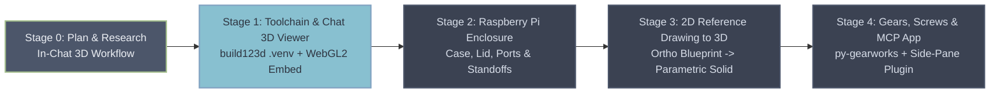

# learn_AI_CAD_design

Headless, AI-assisted **3D-printing CAD** pipeline on **Ubuntu 26.04 LTS** (`Python 3.14`), engineered for a pure **prompt -> spin/zoom 3D directly inside Antigravity chat -> prompt tweaks -> print** workflow (never opening external CAD software). Built on pure headless **`build123d`** (OpenCASCADE 8.0 B-Rep), automated Python 3D-print DFM/render checks, and CSP-safe offline **WebGL2 `<agent-embed>`** interactive 3D chat widgets (upgrading later to a persistent Antigravity CAD MCP App).

---

## 1. Repository Structure

The repository follows the standardized tripartite **Subproject-Driven Architecture** (`RULE-REPO-001`):

```text
learn_AI_CAD_design/
├── readme.md                                       # Master project guide, Mermaid roadmap & status dashboard
├── .gitignore                                      # Python .venv, G-code & temporary mesh ignore rules
├── blueprints/                                     # Architecture plan, research comparisons & immutable diary
│   ├── overall.md                                  # Locked v4.0.0 in-chat 3D architecture plan
│   ├── diary.md                                    # Append-only daily engineering journal (RULE-DIARY-001)
│   ├── research/                                   # 8-tool CAD landscape & MCP trade-off docs
│   ├── toolchain_setup/                            # Stage 1: Setup blueprint & empirical evidence
│   ├── rpi_enclosure/                              # Stage 2 (Planned): Raspberry Pi case & lid
│   ├── reference_drawing_to_3d/                    # Stage 3 (Planned): 2D drawing -> 3D solid
│   └── gears_and_screws/                           # Stage 4 (Planned): Gears, threads & MCP App
├── hw/                                             # Released .3mf, .step & audit PNG deliverables
│   ├── common/                                     # Shared FDM tolerance profiles & reference board data
│   └── subprojects/                                # Isolated per-stage CAD outputs
└── sw/                                             # Parametric build123d generators, chat viewer & audit helpers
    ├── common/                                     # setup_env.sh, requirements.txt, export_chat_3d.py, print_audit.py
    └── subprojects/                                # Isolated per-stage generator scripts & smoke tests
```

---

## 2. Multi-Stage Project Roadmap



### Stage Breakdown & Status

| Stage | Subproject | Description | Status | Primary Reference |
| :---: | :--- | :--- | :---: | :--- |
| **Stage 0** | **`plan_and_research`** | Host audit on Ubuntu 26.04 (`Python 3.14.4`), 8-tool CAD + MCP trade-offs, and locked `v4.0.0` in-chat 3D plan. | <span style="color: #A3BE8C;">**Completed**</span> | [Plan](blueprints/overall.md) / [Landscape](blueprints/research/cad_software_landscape_3dp.md) / [MCP](blueprints/research/cad_mcp_pros_cons_concerns.md) |
| **Stage 1** | **`toolchain_setup`** | Scaffold tripartite repo, configure zero-`sudo` `Python 3.14` `.venv` (`build123d`, `trimesh`, `manifold3d`, `matplotlib`, `Pillow`), build `export_chat_3d.py` WebGL2 inline viewer + `print_audit.py`, and run live 3D smoke test. | <span style="color: #88C0D0;">**In Progress**</span> | [Plan](blueprints/overall.md#1-single-engine-headless-architecture) |
| **Stage 2** | **`rpi_enclosure`** | Simple 3D-printed Raspberry Pi case + lid (`M2.5` standoffs, USB/Ethernet/HDMI/USB-C cutouts, vents, rounded corners, lip/snap-fit)—iterated via chat prompts and inline 3D rotation. | <span style="color: #4C566A;">**Planned**</span> | — |
| **Stage 3** | **`reference_drawing_to_3d`** | Feed 2D dimensioned orthographic drawings to chat, extract datums/cuts, synthesize the parametric 3D solid, and inspect in-chat 3D + ortho overlays. | <span style="color: #4C566A;">**Planned**</span> | — |
| **Stage 4** | **`gears_and_screws`** | Add `py-gearworks` + `bd-warehouse` for printable nuts/bolts and involute/planetary/worm gears with FDM `backlash`, plus optional Phase B Antigravity CAD MCP App side-pane upgrade. | <span style="color: #4C566A;">**Planned**</span> | — |

---

## 3. Core Workflow Highlights

1. **Zero External CAD Software:** Pure headless `build123d` (`Python 3.14` `.venv`) compiles `.3mf` and `.step` solids directly from clean parametric Python scripts in Git.
2. **Interactive 3D Right Inside Chat:** Offline WebGL2 `<agent-embed>` widgets let you drag-to-rotate, zoom, toggle lids/sub-parts, enable X-Ray, and scrub a live Z cross-section slider directly in Antigravity Desktop or **Remote Control** browsers.
3. **Chronological Narrative:** Key trade-offs, pivots, and empirical milestones are recorded immutably in [diary.md](blueprints/diary.md).
