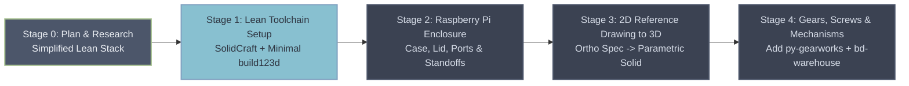

# learn_AI_CAD_design

Headless, AI-assisted **3D-printing CAD** pipeline on **Ubuntu 26.04 LTS** over Remote-SSH, pairing headless **`SolidCraft`** (`solidcraft-cli mcp --headless`, editable `.sc` timelines) and minimal **`build123d`** (`build123d-mcp`) with interactive 3D orbit/zoom inside Antigravity (`o3dv-viewer`) and headless `PrusaSlicer` CLI printability verification.

> [!NOTE]
> **Current Repository State (Planning & Research Phase Only):** The simplified architecture plan ([overall.md](blueprints/overall.md)), 8-tool CAD/MCP research comparisons, and Day 1 diary are documented here. Code and hardware scaffolding (`hw/`, `sw/`, `.venv`, and stage workspaces) has **not started yet**.

---

## 1. Current Repository Files

```text
learn_AI_CAD_design/
├── readme.md                                       # Master project guide, Mermaid roadmap & status dashboard
├── .gitignore                                      # Python .venv, G-code & temporary mesh ignore rules
└── blueprints/                                     # Architecture plan, research comparisons & immutable diary
    ├── overall.md                                  # Simplified v3.0.0 headless 3DP architecture plan
    ├── diary.md                                    # Append-only daily engineering journal (RULE-DIARY-001)
    └── research/                                   # Ecosystem & MCP trade-off research
        ├── cad_software_landscape_3dp.md           # 8-tool CAD comparison for Ubuntu 3D printing
        └── cad_mcp_pros_cons_concerns.md           # CAD MCP architectures, quotas, kernel bugs & Remote-SSH UX
```

*(Future `hw/` and `sw/` scaffolding layout is documented in [overall.md](blueprints/overall.md#4-target-repository-layout) and deferred until Stage 1 kickoff.)*

---

## 2. Multi-Stage Project Roadmap



### Stage Breakdown & Status

| Stage | Subproject | Description | Status | Primary Reference |
| :---: | :--- | :--- | :---: | :--- |
| **Stage 0** | **`plan_and_research`** | Host audit on Ubuntu 26.04 (`Python 3.14.4`), 8-tool CAD + MCP trade-offs, and simplified `v3.0.0` starting plan (`zero FEA/CNC bloat`). | <span style="color: #A3BE8C;">**Completed**</span> | [Plan](blueprints/overall.md) / [Landscape](blueprints/research/cad_software_landscape_3dp.md) / [MCP](blueprints/research/cad_mcp_pros_cons_concerns.md) |
| **Stage 1** | **`toolchain_setup`** | Scaffold `hw/`/`sw/`, install `SolidCraft` (`solidcraft-cli mcp --headless`), minimal `.venv` (`build123d` + `build123d-mcp`), `prusa-slicer` CLI, and Antigravity `o3dv-viewer`; smoke-test a 3D box. | <span style="color: #88C0D0;">**Deferred / Next**</span> | [Plan](blueprints/overall.md#1-lean-headless-toolchain) |
| **Stage 2** | **`rpi_enclosure`** | Simple 3D-printed Raspberry Pi case + lid (`M2.5` standoffs, USB/Ethernet/HDMI/USB-C cutouts, vents, rounded corners, lip/snap-fit)—testing `SolidCraft` vs. `build123d`. | <span style="color: #4C566A;">**Planned**</span> | — |
| **Stage 3** | **`reference_drawing_to_3d`** | Feed 2D dimensioned orthographic drawings to Antigravity, extract datums/cuts, synthesize the parametric 3D solid, and compare ortho views. | <span style="color: #4C566A;">**Planned**</span> | — |
| **Stage 4** | **`gears_and_screws`** | Add `py-gearworks` + `bd-warehouse` to design clearance-tuned printable nuts/bolts, involute/planetary/worm gears with FDM `backlash`, and lead screws *(with KiCad PCB enclosures later)*. | <span style="color: #4C566A;">**Planned**</span> | — |

---

## 3. Core Workflow Highlights

1. **Lean Start, Modular Expansion:** Start with just `SolidCraft` headless MCP (editable `.sc` timelines), minimal `build123d` + `build123d-mcp` (`.step`/`.3mf` B-Rep), `o3dv-viewer` inside Antigravity, and `PrusaSlicer` CLI—deferring gear/thread packages until Stage 4.
2. **In-Antigravity 3D Inspection Over Remote-SSH:** Click any generated `.step` or `.3mf` file in Antigravity's Explorer to rotate, pan, zoom, toggle sub-parts, and auto-reload directly inside an editor tab.
3. **Chronological Narrative:** Key trade-offs, kernel/quota discoveries, and pivots are logged in [diary.md](blueprints/diary.md).
