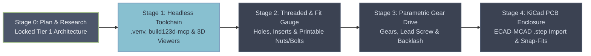

# learn_AI_CAD_design

Headless, AI-assisted **Python 3.14** B-Rep CAD (`build123d` + `build123d-mcp`) and **3D-printing** (`FDM`/`SLA`) pipeline on **Ubuntu 26.04 LTS** over Remote-SSH, featuring interactive 3D rotation/zooming/sectioning inside Antigravity (`o3dv-viewer` + `OCP CAD Viewer`), involute gears (`py-gearworks`), printable screw threads (`bd-warehouse`), headless `PrusaSlicer` printability verification, and KiCad `.step` enclosure integration.

> [!NOTE]
> **Current Repository State (Planning & Research Phase Only):** The architecture plan ([overall.md](blueprints/overall.md)), 8-tool CAD/MCP research comparisons, and project diary are locked on **Tier 1 (`Python 3.14`-only, `~430 MB` unpacked)** and published here. Code and hardware directory scaffolding (`hw/`, `sw/`, `.venv`, and subproject workspaces) has **not started yet**.

---

## 1. Locked Tier 1 Stack & Current Files

```text
learn_AI_CAD_design/
├── readme.md                                       # Master project guide, Mermaid roadmap & status dashboard
├── .gitignore                                      # Python .venv, G-code & temporary mesh ignore rules
└── blueprints/                                     # Architecture plan, research comparisons & immutable diary
    ├── overall.md                                  # Locked Tier 1 Stage 0 architecture plan (v2.1.0)
    ├── diary.md                                    # Append-only daily engineering journal (RULE-DIARY-001)
    └── research/                                   # Ecosystem & MCP trade-off research
        ├── cad_software_landscape_3dp.md           # 8-tool CAD comparison for Ubuntu 3DP, gears & screws
        └── cad_mcp_pros_cons_concerns.md           # CAD MCP architectures, quotas, kernel bugs & Remote-SSH UX
```

*(Future tripartite `hw/` and `sw/` scaffolding following `RULE-REPO-001` is documented in [overall.md](blueprints/overall.md#51-target-future-scaffolding-layout) and deferred until Stage 1 kickoff.)*

---

## 2. Multi-Stage Project Roadmap



### Stage Breakdown & Status

| Stage | Subproject | Description | Status | Primary Reference |
| :---: | :--- | :--- | :---: | :--- |
| **Stage 0** | **`plan_and_research`** | Host audit on Ubuntu 26.04 (`Python 3.14.4`), 8-tool CAD + MCP trade-off analysis, and locked Tier 1 architecture plan (`zero FEA/CNC bloat`). | <span style="color: #A3BE8C;">**Completed**</span> | [Plan](blueprints/overall.md) / [Landscape](blueprints/research/cad_software_landscape_3dp.md) / [MCP](blueprints/research/cad_mcp_pros_cons_concerns.md) |
| **Stage 1** | **`toolchain_setup`** | Scaffold `hw/`/`sw/` (`RULE-REPO-001`), install Tier 1 `.venv` (`build123d`, `build123d-mcp`, `py-gearworks`, `bd-warehouse`, `ocp-vscode`) + `apt` (`f3d`, `librsvg2-bin`, `prusa-slicer`) + Antigravity 3D extensions, and pass smoke tests. | <span style="color: #88C0D0;">**Deferred / Next**</span> | [Plan](blueprints/overall.md#23-locked-tier-1-component-and-storage-breakdown) |
| **Stage 2** | **`threaded_fit_gauge`** | Printable calibration coupon testing clearance holes, M3 heat-set insert bosses, `45 deg` overhangs, and a bolt/nut flank clearance matrix (`0.10–0.30 mm`). | <span style="color: #4C566A;">**Planned**</span> | — |
| **Stage 3** | **`parametric_gear_drive`** | Parametric 3D-printed gear reduction + lead-screw assembly (`py-gearworks` + `bd-warehouse`) with calibrated tooth `backlash` and cross-section collision proofs. | <span style="color: #4C566A;">**Planned**</span> | — |
| **Stage 4** | **`pcb_snapfit_enclosure`** | Import a `.step` board from [`learn_AI_PCB_design`](https://github.com/DevilSu/learn_AI_PCB_design) into `build123d` to generate a snap-fit / M3-boss 3D-printed enclosure with proven `0.0 mm^3` interference. | <span style="color: #4C566A;">**Planned**</span> | — |

---

## 3. Core Workflow Highlights

1. **Pure Python B-Rep (`build123d` + `build123d-mcp`):** Uses standard ordered CAD operations (`extrude`, `revolve`, `sweep`, `loft`, `fillet`, `chamfer`, `Mode.SUBTRACT`) and `@dataclass` parameters, exporting both `.3mf` (for slicing) and exact analytic `.step` (for external CAD software like Onshape/FreeCAD/Fusion).
2. **In-Antigravity 3D Viewing Over Remote-SSH:** Orbit, pan, zoom, and auto-reload `.step`/`.3mf` models via `nahueltaibo.o3dv-viewer`, plus inspect part trees and live X/Y/Z cross-section sliders via `ocp-cad-viewer` (`port 3939`).
3. **Chronological Narrative:** Key trade-offs, kernel/quota traps, and discoveries are recorded immutably in [diary.md](blueprints/diary.md).
